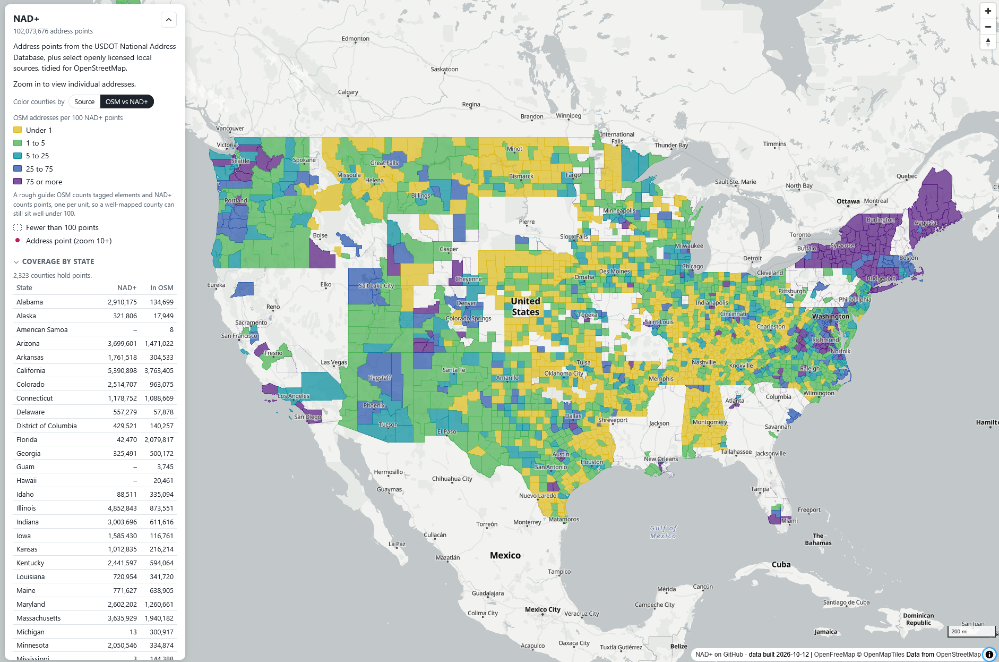

# NAD+

Address points from the USDOT National Address Database, plus a few openly licensed city/county/state
sources, tidied for OpenStreetMap and published as one PMTiles file.

Browse the data at **<https://watmildon.github.io/nad-endpoint/>**. 

## Before you put it in OpenStreetMap

This is reference data, not ground truth, and it is not an import on its own.

- **Follow the import process.** Adding addresses in bulk needs the
  [OSM import guidelines](https://wiki.openstreetmap.org/wiki/Import/Guidelines) and local
  community agreement. Check for existing addresses first.
- **Several points can share a position.** Units of one building, or a building with and
  without units. The one with no `addr:unit` is the building-level address, not a duplicate.
- **Directionals are not conflicts.** `addr:street` is expanded from the source and is not
  checked against OSM road names. OSM may lack, or carry, a directional that the address has.
- **Some cities and postcodes are derived.** Where the source had none, the city comes from
  the state's own 911 dataset, a Census place or New England town polygon, or the ZIP polygon
  the point falls in. The tileset does not mark which values are derived.
- **Placement varies.** Points sit wherever the source put them: rooftop, entrance, parcel
  centroid or unknown. The tileset does not say which.

## Coverage

The tileset covers what NAD covers, which is not the whole country, plus the local sources
listed below. As of r24 there are no points for Hawaii, Nevada, New Hampshire, Puerto Rico,
Guam, American Samoa or the Northern Mariana Islands, only a handful for Michigan and
Mississippi, and several other states are partial. The viewer's **Coverage by state** table and the county overlay show
what is present, and the coverage GeoJSON carries the same counts for scripts.

### Local sources beyond NAD

Each has a definition in [sources/](sources/) recording its licence, where it was verified,
and how its fields map. Only CC0, public domain, PDDL, or a reuse permission recorded on the
OSM wiki is accepted.

| Area | Publisher | Licence |
|---|---|---|
| Los Angeles, CA | City of Los Angeles, Bureau of Engineering | CC0 1.0 |
| Fresno County, CA | County of Fresno / City of Fresno | CC0 |
| San Diego County, CA | SanGIS / SANDAG | SanGIS agreement with explicit OSM permission |
| San Francisco, CA | City and County of San Francisco | PDDL 1.0 |
| Forsyth County, GA | Forsyth County via Esri Community Maps (2021) | CC BY 4.0 with Esri's OSM waiver |
| Hinesville, GA | City of Hinesville via Esri Community Maps (2021) | CC BY 4.0 with Esri's OSM waiver |
| Jefferson Parish, LA | Jefferson Parish GIS | OSM permission recorded on the wiki |
| New Orleans, LA | City of New Orleans | CC0 1.0 |
| Chester County, PA | Chester County via Esri Community Maps (2021) | CC BY 4.0 with Esri's OSM waiver |
| Lackawanna County, PA | City of Scranton GIS (2017 re-host) | PDDL 1.0 |
| Charleston, SC | City of Charleston GIS | Public domain, City Open Data Policy |

## Licence and attribution

NAD is public domain (US Department of Transportation). Values derived from Census
boundaries are public domain. The local sources carry the terms in the table above. No
attribution tag is needed on OSM objects; record the source in the changeset instead, for
example `source=NAD+` or the specific local dataset.

## Problems with the data

Open an issue at <https://github.com/watmildon/nad-endpoint/issues>. The most useful report
has the state, the `addr:street` or `addr:city` value as published, what it should be, and
roughly where. Problems that come from the source agency's data are usually passed on
rather than patched here; problems in the expansion or city rules are fixed in the next
build.

## About the pipeline

This repository also holds the Python pipeline that builds the tileset. It downloads the NAD
release, applies the field and street rules, fills missing cities and postcodes, drops
duplicates, and runs tippecanoe to build the tiles. Pipeline documentation is separate from
this consumer guide; see [docs/](docs/) and the module docstrings under
[src/nad_pipeline/](src/nad_pipeline/).
